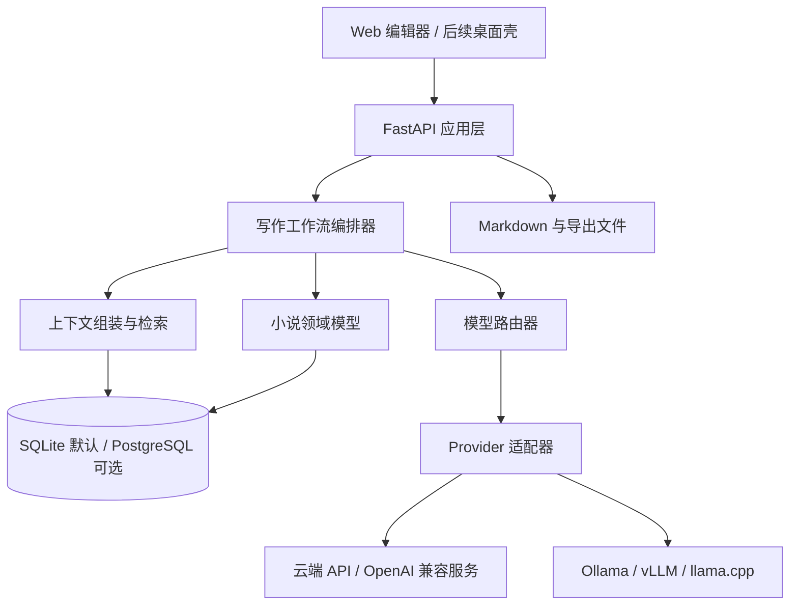

# ChatNovel 结构化方案

> 模型、硬件档位与可选预算预设见 [模型选型与硬件适配方案](model-selection.md)。项目支持纯 API、纯本地和混合部署，不限定单一硬件配置。

> 针对增量创作、连续性约束和文风学习的详细设计见 [requirements-v2.md](requirements-v2.md)。

## 1. 项目定位

ChatNovel 是一个面向长篇小说创作的开源写作工作台。它的重点不是“让模型一次生成整本小说”，而是把长篇创作拆成可检查、可回滚、可协作的步骤，让模型负责局部工作，让作者掌握故事的最终决定权。

第一阶段的产品承诺是：

- 作者可以从故事想法建立一个项目，并维护世界观、人物、时间线和风格规则。
- 作者可以把全书拆成卷、章、场景，并在编辑器中对单个场景执行续写、改写、压缩、扩写和校对。
- 每次模型调用都能看到使用了哪些上下文、使用了哪个模型，并且可以接受、拒绝或继续修改结果。
- 同一套工作流可以切换云端 API、本地模型或混合模型，不需要改动业务代码。
- 项目数据默认保存在本机，能够导出为 Markdown 等开放格式。

第一阶段不承诺以下内容：

- 全自动生成一部长篇小说。
- 复杂的多人实时协作和在线社区。
- 训练新的基础模型。
- 依赖某一家模型厂商的专有功能才能工作。

## 2. 关键判断：模型采用“统一接口 + 混合部署”

不建议现在就把产品押在“只用云端 API”或“只用本地小模型”上。正确的切分方式是把模型作为可替换基础设施，把业务流程和模型调用隔开。

| 方案 | 优点 | 代价 | 适合的任务 |
| --- | --- | --- | --- |
| 云端 API | 初始质量高，长上下文和工具能力较完整，不要求用户有显卡 | 按量计费，需要联网，作品内容需要离开本机 | 长段落初稿、复杂改写、结构设计 |
| 本地模型 | 私密、可离线、边际成本低、可自定义 | 需要硬件和安装，速度与长文本质量受限 | 摘要、事实抽取、检索、格式化、轻量改写 |
| 混合部署 | 可以按任务平衡质量、成本、隐私和速度 | 配置和路由逻辑稍复杂 | 长期产品形态 |

推荐的实施顺序：

1. **从第一天建立统一 Provider 接口。** 业务层只知道“执行写作任务”，不知道是 OpenAI、Ollama 还是其他服务。
2. **MVP 先接 OpenAI 兼容接口。** 它最容易验证写作流程，也能连接多种云端服务、自建 vLLM、LM Studio 或其他兼容服务。
3. **同时保留 Ollama 适配器的最小实现。** 先用于摘要、人物/事实抽取和嵌入，之后再评估本地模型是否适合承担长段落创作。
4. **用任务配置选择模型，而不是全局固定一个模型。** 例如规划和长段落写作使用高质量模型，抽取和摘要使用便宜或本地模型。

这样做的结果是：用户可以先无显卡地使用产品，之后只修改模型配置就能切换到本地或混合模式；产品团队也能用统一的评测集比较不同模型，而不是凭感觉争论模型路线。

## 3. 产品对象与写作流程

### 3.1 核心对象

一个小说项目至少包含以下对象：

- **项目（Project）**：书名、语言、类型、目标字数、创作状态和项目级设置。
- **故事圣经（Bible）**：人物、地点、组织、物品、规则、主题、叙事视角和风格指南。
- **大纲（Outline）**：卷、章、场景的层级结构，以及每个节点的目标、冲突、转折和结果。
- **文稿（Document）**：可编辑的章节或场景正文。
- **事实（Fact）**：已经在故事中成立的陈述，例如“林舟在第三章失去左手”。事实有来源、置信度和确认状态。
- **时间线（Timeline）**：故事内时间、事件顺序、人物年龄和因果关系。
- **运行记录（Run）**：一次 AI 操作的任务类型、模型、提示词、上下文、输出、耗时和费用。
- **修订版本（Revision）**：文稿的每次保存版本，支持对比、回滚和追踪来源。

### 3.2 推荐工作流


每个环节都应该是可单独执行的命令。不要在 MVP 中实现一个持续自主决策的“智能体循环”，否则很难定位错误、控制成本和恢复中断。

建议的 AI 命令集合：

| 命令 | 输入 | 输出 | 是否直接改正文 |
| --- | --- | --- | --- |
| `plan_story` | 故事概念、约束 | 结构化大纲草案 | 否 |
| `expand_scene` | 场景卡、上下文 | 场景正文草案 | 否，先展示差异 |
| `continue_text` | 光标位置、当前场景 | 续写片段 | 否，先展示差异 |
| `rewrite_scene` | 选中文本、改写要求 | 改写版本 | 否，先展示差异 |
| `summarize_scene` | 场景正文 | 摘要、关键事实、悬念 | 更新候选数据，需确认 |
| `check_continuity` | 场景与故事圣经 | 冲突列表、证据来源 | 否 |
| `polish_prose` | 选中文本、风格规则 | 润色版本 | 否，先展示差异 |
| `extract_facts` | 新增正文 | 候选事实和时间线事件 | 否，需人工确认 |

## 4. 系统架构

### 4.1 分层结构



### 4.2 推荐技术栈

| 层 | MVP 推荐 | 选择理由 |
| --- | --- | --- |
| 前端 | Next.js、TypeScript、Tiptap/ProseMirror | 编辑器生态成熟，便于实现选区操作、差异预览和流式输出 |
| 后端 | Python、FastAPI、Pydantic | AI SDK、文本处理和本地模型生态完整，接口清晰 |
| 数据库 | SQLite 默认，PostgreSQL 可选 | 单人本地使用简单，后续可扩展到多人服务 |
| 检索 | SQLite FTS5 起步，向量检索后置 | 先降低部署和调试成本，结构化数据足够时不必马上引入向量库 |
| 本地模型 | Ollama HTTP API；兼容 vLLM/llama.cpp | 本地用户安装门槛较低，服务接口稳定 |
| 文件格式 | 内部结构化存储 + Markdown 导入/导出 | 保护可迁移性，避免内容锁在数据库中 |
| 运行方式 | Docker Compose + 本地开发命令 | 让没有 Python/Node 环境的用户也能启动 |

建议采用一个轻量 monorepo：

```text
chatnovel/
├─ apps/
│  └─ web/                 # Next.js 前端
├─ services/
│  └─ api/                 # FastAPI 后端与写作工作流
├─ packages/
│  ├─ schemas/             # JSON Schema、OpenAPI 类型和共享 DTO
│  ├─ providers/           # 模型 Provider 接口与适配器
│  ├─ prompts/             # 版本化提示模板与上下文格式
│  └─ evals/               # 评测样例与指标
├─ docs/
├─ data/                   # 本地运行数据，不提交用户作品
├─ docker-compose.yml
└─ README.md
```

前端、后端和共享类型可以分开发布；但 MVP 不应拆成微服务，单个 API 进程足够承载写作任务。

## 5. 模型抽象与路由

### 5.1 Provider 接口

业务代码只依赖类似下面的接口，具体 SDK 放在适配器中：

```python
class ModelProvider(Protocol):
    def capabilities(self) -> ProviderCapabilities: ...

    async def chat(
        self,
        request: ChatRequest,
    ) -> AsyncIterator[ChatChunk]: ...

    async def structured(
        self,
        request: StructuredRequest,
        schema: JsonSchema,
    ) -> StructuredResult: ...

    async def embed(self, texts: list[str]) -> list[list[float]]: ...
```

`embed` 和 `structured` 应该是可选能力。只支持文本生成的模型仍然可以完成续写；需要结构化抽取时，编排器可以使用 JSON 模式、函数调用或受控解析作为不同的适配策略。

### 5.2 Model Profile

不要在业务代码中写死模型名，用配置描述模型能力：

```yaml
profiles:
  drafter:
    provider: openai-compatible
    model: <configured-by-user>
    temperature: 0.8
    max_output_tokens: 6000
    privacy: remote
  extractor:
    provider: ollama
    model: <configured-by-user>
    temperature: 0.1
    max_output_tokens: 2000
    privacy: local
```

至少预留以下任务角色：

- `planner`：大纲、场景目标和因果关系。
- `drafter`：场景和章节正文。
- `editor`：风格、节奏、视角和语言修改。
- `extractor`：人物、事实、时间线和摘要的结构化抽取。
- `critic`：连续性、重复、悬念和逻辑问题检查。
- `embedder`：可选的本地嵌入模型。

路由器的输入是任务类型、上下文长度、隐私等级、预算和可用能力，输出是一个 Model Profile。初版可以使用静态配置，后续再加入失败重试和按成本切换。

### 5.3 配置方式

配置应同时支持环境变量和项目级设置，密钥不要写进项目文件：

```text
CHATNOVEL_PROVIDER=openai-compatible
CHATNOVEL_BASE_URL=https://example.invalid/v1
CHATNOVEL_API_KEY=stored-in-keyring-or-env
CHATNOVEL_MODEL=drafter-model
CHATNOVEL_OLLAMA_URL=http://localhost:11434
```

用户在界面上看到的是“模型配置”和“任务角色”，而不是一堆供应商专有参数。高级参数可以折叠到高级设置中。

## 6. 上下文工程

长篇小说最容易失败的地方不是调用模型，而是把正确的信息在正确的时机传给模型。每次运行都应生成一个可预览的 `ContextPack`，并保存其摘要和来源 ID。

### 6.1 ContextPack 组成

按优先级组装：

1. 当前用户指令和选中文本。
2. 当前场景卡：目标、冲突、参与人物、地点、预期结果。
3. 当前场景正文和前后文窗口。
4. 大纲路径：卷、章、场景的上级目标。
5. 已确认的故事事实和时间线事件。
6. 相关人物、地点和规则条目。
7. 章节摘要和最近场景摘要。
8. 项目风格指南、叙事视角和禁用项。

每一段上下文都带 `source_id` 和 `source_type`，在界面上显示“本次生成参考了哪些内容”。上下文超过模型预算时，按优先级裁剪，并优先使用已保存摘要，不要静默截断当前用户选中的内容。

### 6.2 检索路线

- MVP 使用 SQLite FTS5，对人物名、地点名、标签、摘要和正文做全文检索。
- 只有当用户确实遇到“语义相关但关键词不同”的问题时，再加入嵌入检索。
- 文本切分以场景、事实条目和摘要为边界，避免把一个事实切成多个无来源的片段。
- 检索结果要经过项目、章节和时间范围过滤；“相关”不等于“当前有效”。

### 6.3 事实与记忆的处理

模型抽取出的信息一律先进入“候选事实”，不能自动成为正史。用户确认后，才写入 `facts` 或 `timeline_events`。每个事实保留：

```text
subject、predicate、object、valid_from、valid_to、source_revision_id、confidence、status
```

这样可以处理“角色曾经受伤但后来康复”这类有时间范围的事实，也能在冲突检查时回溯证据。

## 7. 数据模型

推荐使用关系表保存可查询的核心信息，使用 JSON 保存供应商配置和少量扩展字段：

```text
projects
  id, title, language, genre, settings_json, created_at, updated_at

documents
  id, project_id, kind, parent_id, title, slug, current_revision_id

revisions
  id, document_id, parent_revision_id, content, source, run_id, created_at

outline_nodes
  id, project_id, parent_id, order_index, level, title, goal, conflict, outcome

entities
  id, project_id, entity_type, name, description, status, metadata_json

facts
  id, project_id, subject_entity_id, predicate, object_text,
  valid_from, valid_to, confidence, status, source_revision_id

timeline_events
  id, project_id, order_key, time_label, description, source_revision_id

style_guides
  id, project_id, name, rules_json, active

model_profiles
  id, project_id, role, provider, model, parameters_json, privacy

runs
  id, project_id, task_type, model_profile_id, status,
  input_json, context_manifest_json, output_json,
  prompt_version, usage_json, error, created_at, finished_at

evaluations
  id, run_id, evaluator, metric, score, notes, created_at
```

正文的真正来源是 `revisions`，而不是模型运行输出。模型输出只有在用户接受后才创建新的修订版本。这样可以防止一次错误生成覆盖原稿。

## 8. 界面设计

推荐三栏布局：

- **左栏：项目导航**。卷、章、场景、人物和世界观条目。
- **中栏：编辑器**。支持 Markdown/富文本、选区操作、版本差异和流式生成。
- **右栏：上下文与检查**。显示当前场景卡、相关事实、本次运行使用的上下文、连续性问题和接受/拒绝按钮。

首批交互优先做这些：

1. 选中文本后调用“改写/压缩/扩写/换视角”。
2. 在场景末尾调用“续写”，生成结果以 diff 展示。
3. 点击“生成场景初稿”，先检查场景卡是否完整，再开始运行。
4. 点击“检查连续性”，得到带来源的事项列表，而不是直接修改正文。
5. 查看任意一次运行的提示词版本、模型、上下文和结果。

这比先做一个聊天窗口更适合长篇创作。聊天可以作为辅助入口，但项目结构和正文版本必须是主界面。

## 9. API 设计草案

```text
POST   /api/projects
GET    /api/projects/{project_id}
POST   /api/projects/{project_id}/documents
POST   /api/projects/{project_id}/outline-nodes
GET    /api/projects/{project_id}/context/preview

POST   /api/projects/{project_id}/runs/plan
POST   /api/projects/{project_id}/runs/draft
POST   /api/projects/{project_id}/runs/rewrite
POST   /api/projects/{project_id}/runs/summarize
POST   /api/projects/{project_id}/runs/check-continuity
GET    /api/runs/{run_id}
GET    /api/runs/{run_id}/events       # SSE 流式结果

POST   /api/facts/{fact_id}/confirm
POST   /api/facts/{fact_id}/reject
POST   /api/projects/{project_id}/export/markdown
POST   /api/projects/{project_id}/import/markdown
```

所有写作运行都应返回 `run_id`。前端先创建运行，再通过 SSE 接收增量结果；断线后可以用 `run_id` 恢复，不必重复计费。

## 10. MVP 边界与验收标准

### MVP 必须包含

- 项目、卷、章、场景的基础管理。
- Markdown 或 Tiptap 编辑器。
- 版本保存、diff、回滚。
- OpenAI 兼容 Provider。
- Ollama Provider 的文本生成和结构化输出最小支持。
- 场景卡、人物条目、风格指南。
- `draft`、`rewrite`、`continue`、`summarize`、`check_continuity` 五类命令。
- ContextPack 预览和来源追踪。
- SQLite 本地存储和 Markdown 导出。
- 没有模型配置时仍可纯手工写作和管理项目。

### MVP 暂缓

- 多用户权限、实时协作和评论系统。
- 自动向量数据库部署。
- 多智能体互相辩论。
- 自动发布到网文平台。
- 模型微调和用户数据训练。

### 验收标准

一个新用户在本机完成以下流程，不需要修改代码：

1. 创建项目并写入故事简介、人物和场景卡。
2. 配置一个 OpenAI 兼容服务或本地 Ollama。
3. 生成场景草稿，看到流式输出和上下文来源。
4. 拒绝一次结果，再接受另一次结果，查看两个版本的差异。
5. 执行连续性检查并确认一条候选事实。
6. 导出 Markdown，删除本地数据库后能够从导出文件恢复主要内容。

## 11. 分阶段路线图

### Phase 0：RFC 与基线（约 3—5 天）

- 固定领域对象和 Provider 接口。
- 定义 10—20 个中文小说小样例作为回归集。
- 写一个命令行脚本，验证同一任务可以调用 OpenAI 兼容接口和 Ollama。
- 确定许可证和贡献指南。

### Phase 1：可用写作闭环（约 2—4 周）

- FastAPI + SQLite + 前端项目骨架。
- 项目、场景、正文版本和 Markdown 导出。
- Provider 配置、流式生成、diff 接受/拒绝。
- 完成 `continue`、`rewrite`、`draft`。

### Phase 2：长篇一致性（约 3—5 周）

- 人物/地点/规则条目和场景卡。
- 场景与章节摘要。
- FTS5 检索和 ContextPack 预览。
- 事实抽取、人工确认、时间线。
- 连续性检查和带来源的问题列表。

### Phase 3：模型与质量体系（约 4—6 周）

- 任务级模型路由和成本统计。
- Ollama/vLLM 的完整适配。
- 可选嵌入检索。
- 固定评测集、人工评分和自动回归。
- Docker Compose、一键备份与恢复。

### Phase 4：社区与扩展（按反馈决定）

- 插件接口：Provider、导入导出、写作命令。
- Tauri 桌面壳和离线体验。
- 多用户协作与权限。
- 面向其他文字工作的模板包，例如剧本、非虚构文章和游戏任务文本。

## 12. 质量、成本和隐私

### 质量评测

不要只用“读起来不错”评价模型。至少记录以下指标：

- 是否遵守场景目标、人物状态和时间线。
- 是否引入未授权的新设定。
- 是否重复前文或循环表达。
- 是否符合视角、语气和长度要求。
- 作者接受率、二次修改幅度和连续性问题密度。
- 延迟、输入/输出 token、单次费用和失败率。

固定样例要同时测试 API 和本地模型；同一个 `ContextPack`、提示版本和任务约束才能比较结果。

### 成本控制

- 默认限制输出长度，并在开始前估算 token。
- 摘要、事实抽取和检索优先使用便宜或本地模型。
- 只把当前任务需要的上下文发送给远端服务。
- 保存 usage 数据，允许用户按项目查看调用量。
- 长任务支持取消和断点恢复。

### 隐私与安全

- API 密钥放在环境变量或操作系统密钥环，不写入项目导出文件。
- 运行日志默认不保存完整密钥和远端原始请求头。
- 导入的小说文本视为不可信内容，不能让其中的指令覆盖系统规则或用户当前任务。
- UI 明确标出“本次内容将发送到远端模型”的边界。
- 本地模式下，作品正文、索引和运行记录默认都留在本机。

## 13. 开源策略

如果希望别人能够自托管但又必须回馈对服务端的修改，完整应用可以考虑 AGPL-3.0；如果优先考虑被其他项目嵌入和商业集成，可以使用 Apache-2.0。一个实用的拆分方式是：

- 应用和服务端：AGPL-3.0。
- 独立的 Provider SDK、Schema 和小型工具库：Apache-2.0 或 MIT。
- 用户创作内容：不附加项目代码许可证，导出时由用户自行决定内容版权。

最终许可证应在写代码前确定，并单独检查各模型、Tokenizer、字体和前端依赖的许可证。

## 14. 需要尽早做出的决定

建议现在先确定以下默认值，其余保持可配置：

| 决定 | 推荐默认值 | 原因 |
| --- | --- | --- |
| 首发形态 | 本地运行的 Web 应用 | 能兼顾易开发、易部署和数据本地化 |
| 默认数据库 | SQLite | 单人创作和备份最简单 |
| 首个模型协议 | OpenAI 兼容 HTTP | 可覆盖云端与多种本地服务 |
| 本地模型入口 | Ollama | 安装和服务管理相对简单 |
| 检索 | FTS5 优先 | 先证明工作流价值，再增加向量复杂度 |
| 生成策略 | 用户触发、差异预览、人工接受 | 可控、可解释、容易回滚 |
| 许可证 | 应用 AGPL-3.0，库按需拆分 | 鼓励自托管改进回流 |

如果下一步开始实现，建议先做 **Phase 0 的 Provider 契约、领域 Schema 和一个命令行写作闭环**，再做漂亮的编辑器。只要同一份场景输入能在两个 Provider 上得到可记录、可比较、可回滚的结果，后面的界面和模型选择就有了稳定基础。
